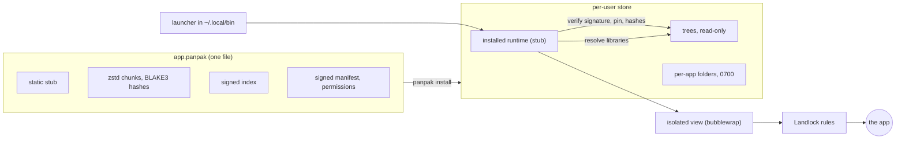

# Panpak

Panpak (pronounced "pan-pak") is a package format and runtime for Linux desktop applications: a
`.panpak` file is verified with a signature before it runs, and the app then runs in a sandbox built
from Landlock and, when available, bubblewrap.

> **Status: pre-alpha.** The format may change without notice, there are no stable releases, and the
> sandbox has known gaps ([Known limitations](THREAT-MODEL.md#5-known-limitations)). Do not use it for
> important data or for software you do not trust.

## The problem

Linux desktop software reaches users in several ways. An AppImage is one file that runs anywhere, but
nothing in it is verified before it runs and it has no sandbox of its own. Flatpak and Snap provide
runtimes, stores and sandboxes, and need their own tooling on the system. These are different
trade-offs, and each fits some cases.

Panpak explores another point between them. One file, which can be built from an AppImage, carries the
app, a signed manifest and a signed index. The runtime checks the signature and every chunk before it
runs anything, uses the libraries of the system when the app does not carry them, and confines the app
with kernel features instead of a separate daemon. Updates fetch only the chunks that changed.

## How it works



What happens when an installed app starts:

1. The launcher runs the installed runtime, never the stub inside the package.
2. The runtime checks the Ed25519 signature over the manifest and the root hash, the key pin made at
   install, the hash of the stub, and the index.
3. On the first start it builds the tree from the package, checking every chunk before it is written;
   the tree is then read-only.
4. It resolves the libraries the app needs: those in the package first (except the C library and the
   graphics stack), the system's otherwise. A missing or incoherent set is an error, not a guess. The
   result is cached.
5. If `/usr/bin/bwrap` works, it starts the app in an isolated view: a new root with only the system
   folders, the app's tree and its own folders, an empty home folder and a runtime folder with only the
   sockets the app may use.
6. Landlock rules are applied (read-only tree, writes only to the app's folders, `/tmp` and the paths
   the manifest names, TCP ports, signals and abstract sockets), a self-test checks them, and the app
   runs.

The format is described in [PANPAK-FORMAT.md](PANPAK-FORMAT.md).

## Security guarantees and their limits

What is tested (see [THREAT-MODEL.md](THREAT-MODEL.md)):

- **Nothing of an installed app runs before verification:** signature, stub hash, index and every chunk
  (two limits of this claim follow the list).
- **Trust on first use, then a pin:** the key is shown at install and enforced at every start; a
  changed key is refused, and signed rotation is supported.
- **Read-only tree, confined writes:** the app writes only to its own folders, `/tmp` and the paths the
  manifest declares. The rest of the home folder is not readable.
- **No silent fallback:** without Landlock the runtime refuses to start the app.
- **Permission changes need a yes:** an update that adds permissions is not installed without one.
- **Local sockets:** with the isolated view, or with Landlock 9 (Linux 7.1), an app cannot reach the
  session bus, ssh-agent, gpg-agent or the sockets of container managers, unless its manifest lists them.

The two limits of the first point:

- **Running a `.panpak` file directly runs its own stub first.** The file is an executable: the stub
  inside it starts, then verifies the package and starts the app. If the file is hostile, that stub can
  do anything the user can, before any check. Install the package instead: `panpak install` verifies it
  with the `panpak` program and the installed runtime, and the launcher never runs the stub of the
  package. Run a `.panpak` directly only if you would run any program from the same source.
- **The runtime itself is not verified when you install it from a local file.** `panpak install-runtime
  <stub> --allow-unsigned` (and `panpak install --runtime <stub>`) installs the stub you give it, and says so
  ("NOT verified"): use a stub you built. A release archive is checked against a signature and a release
  key with `panpak install-runtime <archive> --release-key ...`, but no release has been published yet.

What is not guaranteed includes: X11 gives no isolation between windows; the seccomp filter is a deny list of about fifty calls, not a full policy; GNOME's compositor does not yet offer a Wayland security context, so there the app has the normal Wayland socket; `audio` includes the microphone;
without bubblewrap, Landlock does not stop UDP (an app with no network permission can still send
datagrams, DNS included), and below Landlock 9 the session bus is reachable; the filtered session bus
needs the isolated view, a systemd user manager and `xdg-dbus-proxy`, and there is no file chooser portal,
input method, accessibility or keyring through it; the first key is pinned without proof. With the isolated view, an app with no
network permission has no network but the loopback interface. The complete list, each
with its consequence, is in
[Known limitations](THREAT-MODEL.md#5-known-limitations). Report vulnerabilities as described in
[SECURITY.md](SECURITY.md).

## What Panpak is not

- Not a store: there is no catalogue, search or review. You get a `.panpak` file from its author, or
  convert an AppImage yourself.
- No shared runtime: an app carries the libraries the system does not provide, and uses the system's
  for the rest; Panpak installs no set of common libraries that apps depend on.
- No central repository or service: nothing is hosted by the project, and updates come from the URL in
  the package's manifest.

## Requirements

- **Architecture:** x86-64 Linux. The runtime is a static musl binary built for
  `x86_64-unknown-linux-musl`; other architectures are not supported yet.
- **Kernel, with Landlock enabled** (`landlock` among the active security modules). Linux 5.13 is the
  minimum (Landlock 1, file rules): below it the runtime refuses to start an app. Later versions add:
  Linux 6.7 (Landlock 4) TCP port rules. Without it an app can only be started with
  `--network-unfiltered`, and an app that asks for network is refused. Linux 6.12 (Landlock 6): scopes
  that confine abstract Unix sockets and signals. Linux 7.1 (Landlock 9): rules for Unix sockets by path.
  Details in the table of [THREAT-MODEL.md](THREAT-MODEL.md).
- **bubblewrap** (`/usr/bin/bwrap`, optional) with unprivileged user namespaces. It provides the isolated
  view. Without it the app runs with Landlock alone: below Landlock 9 it can reach the session bus and
  the agents through their sockets, it sees the real `/proc`, `/sys`, `/run` and `/tmp`, it has no own
  process and IPC namespaces, links it opens go to the system `xdg-open` from inside the sandbox, and an
  app with no network permission can still send UDP. `panpak doctor` says whether it is usable and why
  not. On Ubuntu 24.04 and later an AppArmor profile for `bwrap` is needed (the distribution ships one).
- **systemd:** not required. If they exist, the journal socket and the systemd-resolved socket are made
  available to the app (the resolver only if it asks for network), and `XDG_RUNTIME_DIR` is used for the
  sockets and the shared `/tmp` of an app's copies.
- **xdg-dbus-proxy** 0.1.5 or newer (`/usr/bin/xdg-dbus-proxy`, optional, a dependency of Flatpak) with a
  systemd user manager and the isolated view. It gives the app a filtered session bus: the appearance
  and inhibit portals, and, if the manifest asks, notifications, a tray icon and a few named bus names.
  Without it the app has no session bus (no portals, notifications or tray icon). `panpak doctor` says
  whether it is usable.
- **glibc:** no fixed minimum. An app uses the glibc of the system unless its package carries its own;
  an app built against a newer glibc than the system's does not start (Cura needs 2.38 in the
  compatibility tests). `panpak doctor` shows the host's. Hosts with another libc (Alpine) run only
  packages that carry glibc and its loader, or static programs.
- **Also used:** `xdg-open` to open links, a Wayland or X11 session for graphical apps, and for
  `convert` an AppImage with a SquashFS image (DwarFS images are not supported).

## Measured numbers

One machine (Ryzen 7 7735HS, Ubuntu 26.04, kernel 7.0, ext4), three or four apps, apps that exit at
once. Method, raw data, charts and limits are in [docs/BENCHMARKS.md](docs/BENCHMARKS.md); the
scripts download pinned official inputs and can be run again.

<picture>
  <source media="(prefers-color-scheme: dark)" srcset="docs/bench-data/delta-dark.svg">
  
</picture>

| Measure | Result | Method |
|---|---|---|
| Update size, QOwnNotes 26.10.8 to 26.10.9 | 5.3 MB fetched, 7.7% of the 68.3 MB package | bytes counted by a local server ([update size](docs/BENCHMARKS.md#update-size)) |
| Update size, Simplenote 2.27.0 to 2.27.1 | 1.7 MB fetched, 1.1% of 156 MB | same |
| Update size, AppImageLauncher 2.2.0 to 3.0.0-beta-3 | 39.5 MB fetched, 90.1% of 43.9 MB | same |
| First start after install | 0.3 to 0.7 s | median of 5, new HOME each ([start time](docs/BENCHMARKS.md#start-time)) |
| Later start, warm | 42 to 87 ms (3 apps) | median of 10, command that exits |
| Cost of the isolated view | about 15 to 18 ms per start | with and without, alternating ([view](docs/BENCHMARKS.md#cost-of-the-isolated-view)) |
| Library resolution, symbol check included | 13 to 33 ms per start when not cached | cache on and off ([resolution](docs/BENCHMARKS.md#library-resolution)) |

Where Panpak does worse, in the same measurements:

- **The first start extracts the app**: 7 to 12 times a later warm start. An AppImage has no such step.
- **A very small program starts slower**: `ail-cli --help` takes 42 ms against 19 ms for the AppImage.
- **A cold later start is slow and uneven**: 195 to 243 ms in the medians, with wide ranges.
- **An update can save little**: between these two AppImageLauncher releases it fetches 90.1% of the
  package.
- **A package is 6 to 20% larger than the AppImage it came from** in the three pairs measured, and an
  install keeps both the package and the tree.

There is no comparison with Flatpak or Snap yet.

## Quick start

Build from source. The runtime is a static musl binary; Zig acts as the C compiler and linker, from a
pinned wheel. Install it in a virtual environment: recent Ubuntu and Debian block `pip` outside one
(PEP 668), and may need the `python3-venv` package.

```sh
python3 -m venv .venv-zig
.venv-zig/bin/pip install --require-hashes -r tools/requirements-zig.txt     # Zig 0.17.0
export PANPAK_ZIG="$(.venv-zig/bin/python -c 'import os, ziglang; print(os.path.join(os.path.dirname(ziglang.__file__), "zig"))')"
rustup target add x86_64-unknown-linux-musl           # Rust 1.99.1 comes from rust-toolchain.toml
cargo build --release --target x86_64-unknown-linux-musl
export PATH="$PWD/target/x86_64-unknown-linux-musl/release:$PATH"
```

Convert an AppImage, install it, run it:

```sh
panpak keygen -o my.key                                    # your signing key (keep it private)
panpak convert App.AppImage --id org.example.app \
    --stub target/x86_64-unknown-linux-musl/release/panpak-stub \
    --secret-file my.key -o app.panpak                     # add --entry PATH if it asks for one
panpak install-runtime target/x86_64-unknown-linux-musl/release/panpak-stub --allow-unsigned   # your own build
panpak install app.panpak                                  # shows the key fingerprint to pin
~/.local/bin/org.example.app
panpak doctor                                              # kernel, Landlock, bubblewrap, runtime
panpak list                                                # what is installed and what it weighs
panpak remove org.example.app                              # take it away; your data stays (--purge-data deletes it too)
```

`convert` signs with your key: the package says it was converted by you, not by the app's authors.
[QUICKSTART.md](QUICKSTART.md) shows how to pack a folder, open files and update.

## Compatibility

Twenty-five AppImages were tried on this setup (details, versions and causes in
[docs/COMPATIBILITY.md](docs/COMPATIBILITY.md)): 15 start (14 show a window: Qt 6, GTK 3, Electron; one
is a terminal program), 1 starts without a window in the test setup, 4 convert but do not start, 1 cannot
be converted (DwarFS image), and 4 fail because libraries they expect are not on the system. Some need
`--entry` or `--allow-missing`. In this round no GUI input was tested beyond the start.

## License

The source code is licensed under either of the Apache License, Version 2.0
([LICENSE-APACHE](LICENSE-APACHE)) or the MIT license ([LICENSE-MIT](LICENSE-MIT)), at your option.
Third-party components are listed in [THIRD-PARTY-LICENSES](THIRD-PARTY-LICENSES); `panpak licenses`
shows the texts carried by a binary or a package. The specification and the other documents are
licensed under [CC BY 4.0](LICENSE-DOCS), with a patent non-assertion statement for conforming
implementations (see PANPAK-FORMAT.md, Appendix D). Contributions are accepted under these licenses and
signed off under the DCO, see [CONTRIBUTING.md](CONTRIBUTING.md).

The name "Panpak" and its logo follow a usage policy, see [TRADEMARKS.md](TRADEMARKS.md).
