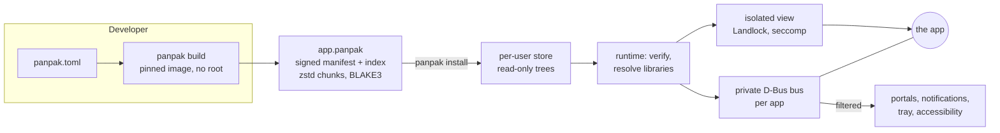
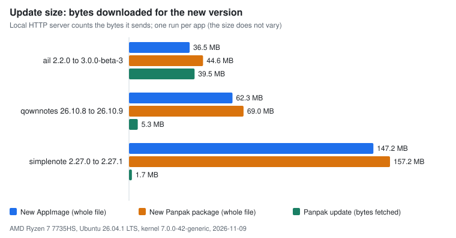

# Panpak

**A package format for Linux apps, desktop and command line: one signed file, a layered sandbox, no runtime to download, no root.**

A `.panpak` file carries an application, a signed manifest of what it may do, and a signed index of
every byte. The signature is checked at every start, and every piece when the app is first unpacked. Then it starts in a sandbox
built from kernel features, with its own private D-Bus bus; starting an app through all of that adds about 29 ms.

> **Status: pre-beta.** The format is not stable yet and there are no releases.
> Please do not publish packages made with this code: there is no registry, no key policy and no review process yet.
> Do not use it for important data or for software you do not trust. Source builds work for three example
> programs only. Known limits are listed in [THREAT-MODEL.md](THREAT-MODEL.md#5-known-limitations); the plan is in
> [Roadmap](#roadmap).

## Why Panpak

### Secure by construction

- **Nothing is made or run before it is verified.** Ed25519 signature over the manifest and the index, BLAKE3 hash
  of every chunk, key pinned at install (trust on first use). The signature and the pinned key are checked at every
  start, and a changed key is refused; key rotation is signed. Every chunk is checked when the app's tree is made,
  at the first start, and the tree is then read-only. It is not rehashed at every start, so a process of your own
  user outside the sandbox could still change it ([KL-18](THREAT-MODEL.md#5-known-limitations)).
- **A sandbox in layers, each one doing one job:**
  - an isolated view (bubblewrap) with only what the app needs: system folders, its own read-only tree,
    its own data folders, an empty home;
  - Landlock rules on files and, as far as the kernel has them, TCP ports (Linux 6.7), signals and abstract
    Unix sockets (6.12) and Unix sockets by path (7.1);
  - a seccomp filter generated by Panpak itself; user namespaces are always denied;
  - a Wayland security context where the compositor offers it (Sway and the wlroots family, KWin 6.7 and
    later; GNOME's Mutter does not yet);
  - **a private D-Bus bus for each app**: the app owns its names only there, so it can neither
    impersonate nor talk to a native app with the same name. Portals, notifications, tray and
    accessibility reach the desktop through a filter. The router that serves the bus has no
    privileges of its own, and the code that reads the app's messages is fuzzed.
- **Links and files go through narrow channels.** Links open outside the sandbox only for `http`,
  `https` and `mailto`, and the app is told when it fails. An app sees the folders its manifest asks for, and
  a single file only when you open it with `panpak open` or from the file manager.
- **Reproducible.** The same recipe and lock give the same package, byte for byte, in a pinned build image
  (checked by building twice, see [Measured numbers](#measured-numbers)); the release binaries of Panpak itself
  are checked the same way ([REPRODUCIBLE-HASHES.md](REPRODUCIBLE-HASHES.md)).

### Fast

| What | Measured |
|---|---|
| Fixed cost of a start, sandbox and private bus included, launched from the desktop | about 29 ms (26 ms with no bus) |
| qBittorrent built from source, time to its window | 0.16 s |
| Update of QOwnNotes 26.10.8 → 26.10.9 | 5.3 MB downloaded, 7.7% of the package |
| Two GTK 4 apps built in the same image | 61–67% of their stored bytes shared: 32% less to store (a shared store is not built yet) |

Every number has a command to redo it, below in [Measured numbers](#measured-numbers).

### Simple for developers

A recipe says where the source is and what the app may do. `panpak build` does the rest in a pinned,
rootless build sandbox: no Docker, no daemon.

```toml
[app]
id = "org.gnome.TextEditor"
name = "Text Editor"
version = "48.3"
entry = "bin/gnome-text-editor"

[source]
git = "https://gitlab.gnome.org/GNOME/gnome-text-editor.git"
commit = "6f40f0bf2d443471ecc0267e8e87d202b6d1ff6c"

[build]
system = "meson"
configure = ["--prefix=/usr", "--libdir=lib", "--buildtype=release"]
packages = [
  "meson", "ninja-build", "libgtk-4-dev", "libadwaita-1-dev", "libgtksourceview-5-dev",
  "libspelling-1-dev", "libicu-dev", "libenchant-2-dev", "libeditorconfig-dev",
  "blueprint-compiler", "itstool", "appstream", "sassc", "libxml2-utils",
  "gsettings-desktop-schemas", "adwaita-icon-theme", "shared-mime-info", "librsvg2-common",
]
memory = "1.2G"

[collect]
toolkit = "gtk4"
data = ["share/gtksourceview-5"]

[desktop]
icon_svg = "share/icons/hicolor/scalable/apps/org.gnome.TextEditor.svg"
wm_class = "org.gnome.TextEditor"

[permissions]
xdg_dirs = [{ name = "documents", access = "rw" }]

[license]
spdx = "GPL-3.0-or-later"
files = ["COPYING"]
```

`panpak build` checks the memory the build needs before it starts, collects the libraries, plugins and
icons the app uses, writes the minimum glibc version into the manifest, and signs the package. This recipe is
the one in the [Quick start](#quick-start), and it builds in about 10 s once the build image exists (the
first build makes the image: several minutes). See [docs/SOURCE-BUILD.md](docs/SOURCE-BUILD.md).

### Any distribution, and perfect for atomic ones

Panpak never touches the system: apps, their data and the runtime live in your home folder. The same
package runs on distributions with a recent enough kernel and glibc. The CI starts the runtime in containers of Debian 12,
Ubuntu 24.04, Fedora 43 and Alpine; test packages were run by hand on the first three (on Alpine only packages that carry
their own glibc run, see [distro-matrix.md](distro-matrix.md)); real apps are tested on Ubuntu, on Fedora with KDE and on
Bluefin.

On atomic, image-based systems (Fedora Silverblue and Kinoite, Bluefin and Aurora, openSUSE Aeon) this
matters even more:

- **Nothing to layer, no reboot.** Adding a program to the system image usually means layering it and
  rebooting. A Panpak app installs into your home in seconds and runs at once.
- **The image stays untouched.** System updates and rollbacks never change your apps, and installing or
  removing an app never changes the image.
- **Nothing of its own to add to the system.** No daemon, no service, no file in `/usr`: a read-only system is not
  a problem. It uses bubblewrap and xdg-dbus-proxy, which come with Flatpak and are on these systems already.
- **Your apps live in your home.** Rebasing to another image does not touch them or their data.

### Desktop and command-line apps

The same format and the same sandbox serve graphical apps and command-line programs. A terminal tool
starts in the same isolated view, with the same verification, in tens of milliseconds (Neovim, later start: 32 ms).
Terminals and editors with an embedded terminal work too: each app gets a pseudo-terminal of its own,
never yours.

## How it works



When an installed app starts:

1. The launcher runs the installed runtime, never code from the package.
2. The runtime checks the signature, the pinned key and the index; the first start builds the app's
   tree from chunks that are each checked, and the tree is then read-only.
3. It resolves the libraries: those in the package first, the C library and the graphics stack from the
   system. A missing or incoherent set is an error, never a guess.
4. It starts the app in its isolated view, applies Landlock and seccomp, and connects it to its private
   bus.

The format is specified in [PANPAK-FORMAT.md](PANPAK-FORMAT.md); the security model, with every known
limit and its consequence, in [THREAT-MODEL.md](THREAT-MODEL.md).

## What an app can ask for

`install` and `update` show what a package asks for before anything is installed, in the language of the user (English and Italian for now), and `panpak inspect <package or app id>` shows it
again with a sentence on what each permission means. Every permission has a level, always written in words and with a mark (`[ ]` Normal, `[!]` Attention, `[!!]` High risk). The summary says
"Full isolation" when nothing is High risk, and "Partial isolation" with the reason when something is. The list also says what the app cannot do. Only what the sandbox keeps is listed; the table
below is printed by `panpak permissions --markdown`, and a test fails when it is out of date.

<!-- permissions:start -->
| Level | What the app may do | What it means |
|---|---|---|
| \[!!\] High risk | See what other apps show and what you type in them (X11) | X11 has no walls between apps: this app can read the windows and the keyboard input of the others. |
| \[!!\] High risk | Use the message bus of your whole desktop | It can talk to every service of your session, also to start programs and to read what other apps publish. The sandbox does not isolate it any more. |
| \[!!\] High risk | Read, change and delete *x* in your home folder | A place in your home folder that belongs to you, not to the app, is open to it for writing. |
| \[!!\] High risk | Read *x* in your home folder | A place in your home folder that belongs to you, not to the app, is open to it for reading. |
| \[!\] Attention | Connect to the network on the ports *x* | It can reach any computer on these TCP ports, also on the internet. The filter is by port, not by address. |
| \[!\] Attention | Accept connections from the network on the ports *x* | Other computers can connect to this app on these TCP ports. |
| \[!\] Attention | Use the network | It can use the network. The ports are not listed by the package. |
| \[!\] Attention | Play sound and use the microphone | It can use the sound system of your session: play sounds and record from the microphone. |
| \[!\] Attention | Read, change and delete the files in your *x* folder | The folder is the one of your user-dirs.dirs, not a copy. |
| \[!\] Attention | Read the files in your *x* folder | The folder is the one of your user-dirs.dirs. The app cannot change it. |
| \[!\] Attention | Talk to the local service *x* | It can connect to this Unix socket, and so to the program that listens on it. |
| \[ \] Normal | Open the links that start with *x*: | The links of this kind, in your browser or in other apps, are given to this app. |
| \[ \] Normal | Show notifications | It can show messages in the notification area of your desktop, also while it works in the background. |
| \[ \] Normal | Put an icon in the notification area | It can show an icon and a menu there, and it sees which icons are there. |
| \[ \] Normal | Be controlled by the media keys | The shell of your desktop and the media keys of your keyboard can play, pause and skip in it. |
<!-- permissions:end -->

A new language is a file `po/<language>.po`: no code changes. A sentence without a translation is shown in English.

## Panpak and the others

|  | Panpak | AppImage | Flatpak | Snap |
|---|---|---|---|---|
| One file you can copy | yes | yes (needs FUSE 2, or extraction) | a bundle exists, without its dependencies | a `.snap` file; needs snapd and its base snap |
| Checked | signature and key at every start, every chunk when the tree is made | optional signature, validated by an external tool | signed repositories (GPG) | signed assertions with the hash of each snap |
| Sandbox | layered, always on in the isolated view | none | yes, by permissions | yes for strict confinement, not for classic or devmode |
| Shared runtime to download | none | none | yes | base snaps |
| Daemon or root of its own | no | no | not for user installs | snapd, a background service |
| Delta updates | yes, by chunks | if the author embeds update information (zsync) | if the repository publishes deltas | yes, made by the store |

This table compares properties, not speed, and a box says less when its source says less. The sources for every box are in
[docs/BENCHMARKS.md](docs/BENCHMARKS.md#sources-of-the-comparison-table-in-the-readme). Measured comparisons with Flatpak and
Snap on the same apps are planned before the beta; the one with AppImage is in [Measured numbers](#measured-numbers).

## Status and limits

Panpak is pre-beta. What works today: verified install and start, the layered sandbox, the private
D-Bus bus per app, desktop integration (menu entry, icon, uninstall action), delta updates, source
builds for the example recipes. Main limits now (all listed in
[THREAT-MODEL.md](THREAT-MODEL.md#5-known-limitations)):

- GNOME's compositor does not offer a Wayland security context yet; there the app has the normal
  Wayland socket. X11 apps are not isolated from each other.
- The audio permission includes the microphone.
- The file chooser of the desktop portal is not wired yet: apps use their toolkit's own dialog on the
  folders they were granted. The clipboard is not mediated, and there is no keyring.
- The seccomp filter is a deny list, and the internal sandbox of Electron and Chromium is not available.
- The first key of a package is trusted on first use.
- Panpak is not a store: there is no catalogue or review, and no shared runtime. You get a `.panpak` file from its
  author, and updates come from the URL in its manifest. Compatibility with AppImages that you convert yourself
  is in [docs/COMPATIBILITY.md](docs/COMPATIBILITY.md).

Requirements: x86-64 Linux with Landlock enabled (Linux 5.13 or later; newer kernels add more rules),
bubblewrap and xdg-dbus-proxy for the isolated view and the bus (with a systemd user manager), glibc 2.39
or later for packages built with the current image. `panpak doctor` checks a system. Details in
[docs/REQUIREMENTS.md](docs/REQUIREMENTS.md).

## Roadmap

Before the beta, in this order:

1. **File chooser through the portal**: the app receives only the files the user picks, so most apps
   need no folder permission at all.
2. **Shared store and instant start**: pieces shared between apps, apps ready at install, updates
   prepared in the background.
3. **Trust and repository**: certified CI keys, revocation, a signed index, a list of the libraries in
   each package.
4. **App metadata and a Panpak app** to install and manage apps with a few clicks.
5. **Browsers and Electron** in the sandbox, with a broker of our own.
6. **Developer tools**: `panpak init` that understands a project, `panpak run --dev`, a CI template,
   and `panpak trace`, which finds the permissions an app really needs.

## Measured numbers

One machine (Ryzen 7 7735HS, Ubuntu 26.04), medians of several runs. Method, raw data and limits are in
[docs/BENCHMARKS.md](docs/BENCHMARKS.md). Every command runs in an isolated HOME.

<picture>
  <source media="(prefers-color-scheme: dark)" srcset="docs/bench-data/delta-dark.svg">
  
</picture>

| Measure | Result | Redo it |
|---|---|---|
| Fixed cost of a start (desktop / terminal) | 29 ms / 41 ms (no bus: 26 ms) | `python3 tests/startup_budget.py --runs 40 --dbus` from a terminal; for the desktop case run it inside `systemd-run --user --scope --unit app-panpak.org.example.budget-<n>.scope` ([how](docs/BENCHMARKS.md#fixed-cost-of-a-start)) |
| Update size, three apps | 1.1% to 88.6% of the package | `python3 bench/inputs.py fetch && python3 bench/public_bench.py delta` |
| First start after install; later start | 0.3–0.7 s; 38–81 ms | `python3 bench/public_bench.py start` |
| Time to window, apps built from source | Text Editor 0.37 s, qBittorrent 0.16 s, Ghostty 0.27 s | `python3 tests/apps/run.py --apps tests/apps/apps.example.toml --full --group source` |
| Start of a command-line program (later) | Neovim `--version`: 32 ms | [how](docs/BENCHMARKS.md#start-of-a-command-line-program) |
| Chunks shared by two GTK 4 apps | 67% and 61% of the stored bytes; 32% less to store | `python3 bench/shared_chunks.py <text-editor.panpak> <ghostty.panpak>` |
| Same recipe, same package | identical bytes in two builds | `panpak build . -o a.panpak && panpak build . -o b.panpak && cmp a.panpak b.panpak` |

Where Panpak does worse today:

- The first start unpacks the app: 8 to 13 times a later start.
- A tiny command-line program starts slower than its AppImage (38 ms against 20 ms).
- An update can save little when most of an app changes (88.6% for one pair).
- The private bus and its two proxies add about 3 to 4 ms to a start from the menu and 15 to 16 ms from a terminal, and a call to a portal
  takes 150 to 200 µs longer ([docs/PRIVATE-BUS.md](docs/PRIVATE-BUS.md)).

## Quick start

Build Panpak (it prepares Zig and the Rust target by itself, and says what is missing if something is):

```sh
./build.sh
export PATH="$PWD/target/x86_64-unknown-linux-musl/release:$PATH"
```

Build an app from its recipe (the folder that holds `panpak.toml`, the one above), install it, run it:

```sh
panpak build path/to/recipe-folder      # writes org.gnome.TextEditor.panpak in that folder
panpak install path/to/recipe-folder/org.gnome.TextEditor.panpak
~/.local/bin/org.gnome.TextEditor
panpak list
panpak remove org.gnome.TextEditor
```

Nothing else is needed. The first `panpak build` makes your personal key in `~/.config/panpak/secret.key` and says so with its
fingerprint (`--secret-file` uses another one), and `build` and `install` put the runtime that comes with `panpak` (the file
`panpak-stub` beside it) in your home, one line each time. The first build also makes the build image (a few minutes and about
1 GB; it needs network access to the registry and to the Debian snapshot service). `panpak install` shows the fingerprint of the
key and the permissions and asks; in a script, `--yes` confirms after you have checked the fingerprint. `panpak doctor` shows
what the system lacks.

To try Panpak with apps you already have, `panpak convert` turns an AppImage into a package signed by
you: see [QUICKSTART.md](QUICKSTART.md).

## License

Code: Apache License 2.0 ([LICENSE-APACHE](LICENSE-APACHE)) or MIT ([LICENSE-MIT](LICENSE-MIT)), at
your option. Specification and documents: [CC BY 4.0](LICENSE-DOCS), with a patent non-assertion
statement for conforming implementations (PANPAK-FORMAT.md, Appendix D). Third-party components:
[THIRD-PARTY-LICENSES](THIRD-PARTY-LICENSES). Contributions under the DCO, see
[CONTRIBUTING.md](CONTRIBUTING.md). Security reports: [SECURITY.md](SECURITY.md). The name and logo:
[TRADEMARKS.md](TRADEMARKS.md).
