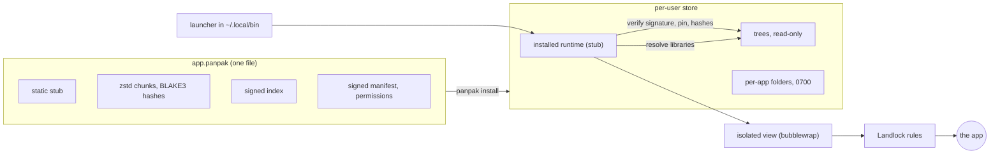

# Panpak

Panpak (pronounced "pan-pak") is a package format and runtime for Linux desktop applications: a
`.panpak` file is verified with a signature before it runs, and the app then runs in a sandbox built
from Landlock and, when available, bubblewrap.

> **Status: pre-alpha.** The format may change without notice, there are no stable releases, and the
> sandbox has known gaps ([Known limitations](THREAT-MODEL.md#5-known-limitations)). Do not use it for
> important data or for software you do not trust.

## The problem

Linux desktop software reaches users in several ways. An AppImage is one file that runs anywhere, but
nothing in it is verified before it runs and it has no sandbox of its own. Flatpak and Snap provide
runtimes, stores and sandboxes, and need their own tooling on the system. These are different
trade-offs, and each fits some cases.

Panpak explores another point between them. One file, which can be built from an AppImage, carries the
app, a signed manifest and a signed index. The runtime checks the signature and every chunk before it
runs anything, uses the libraries of the system when the app does not carry them, and confines the app
with kernel features instead of a separate daemon. Updates fetch only the chunks that changed.

## How it works



What happens when an installed app starts:

1. The launcher runs the installed runtime, never the stub inside the package.
2. The runtime checks the Ed25519 signature over the manifest and the root hash, the key pin made at
   install, the hash of the stub, and the index.
3. On the first start it builds the tree from the package, checking every chunk before it is written;
   the tree is then read-only.
4. It resolves the libraries the app needs: those in the package first (except the C library and the
   graphics stack), the system's otherwise. A missing or incoherent set is an error, not a guess. The
   result is cached.
5. If `/usr/bin/bwrap` works, it starts the app in an isolated view: a new root with only the system
   folders, the app's tree and its own folders, an empty home folder and a runtime folder with only the
   sockets the app may use.
6. Landlock rules are applied (read-only tree, writes only to the app's folders, `/tmp` and the paths
   the manifest names, TCP ports, signals and abstract sockets), a self-test checks them, and the app
   runs.

The format is described in [PANPAK-FORMAT.md](PANPAK-FORMAT.md).

## Security guarantees and their limits

What is tested (see [THREAT-MODEL.md](THREAT-MODEL.md)):

- **Nothing runs before verification:** signature, stub hash, index and every chunk.
- **Trust on first use, then a pin:** the key is shown at install and enforced at every start; a
  changed key is refused, and signed rotation is supported.
- **Read-only tree, confined writes:** the app writes only to its own folders, `/tmp` and the paths the
  manifest declares. The rest of the home folder is not readable.
- **No silent fallback:** without Landlock the runtime refuses to start the app.
- **Permission changes need a yes:** an update that adds permissions is not installed without one.
- **Local sockets:** with the isolated view, or with Landlock 9 (Linux 7.1), an app cannot reach the
  session bus, ssh-agent, gpg-agent or the sockets of container managers, unless its manifest lists them.

What is not guaranteed includes: X11 gives no isolation between windows; UDP is not filtered; there is
no seccomp filter; without bubblewrap and below Landlock 9 the session bus is reachable; there is no
D-Bus filter, portal or keyring yet; the first key is pinned without proof. The complete list, each
with its consequence, is in
[Known limitations](THREAT-MODEL.md#5-known-limitations). Report vulnerabilities as described in
[SECURITY.md](SECURITY.md).

## Measured numbers

One machine (Ryzen 7 7735HS, Ubuntu 26.04, kernel 7.0, ext4), three or four apps, apps that exit at
once. Method, raw data, charts and limits are in [docs/BENCHMARKS.md](docs/BENCHMARKS.md); the
scripts download pinned official inputs and can be run again.

| Measure | Result | Method |
|---|---|---|
| Update size, QOwnNotes 26.10.8 to 26.10.9 | 5.3 MB fetched, 7.7% of the 68.3 MB package | bytes counted by a local server ([update size](docs/BENCHMARKS.md#update-size)) |
| Update size, Simplenote 2.27.0 to 2.27.1 | 1.7 MB fetched, 1.1% of 156 MB | same |
| Update size, AppImageLauncher 2.2.0 to 3.0.0-beta-3 | 39.5 MB fetched, 90.1% of 43.9 MB | same |
| First start after install | 0.3 to 0.7 s | median of 5, new HOME each ([start time](docs/BENCHMARKS.md#start-time)) |
| Later start, warm | 42 to 87 ms (3 apps) | median of 10, command that exits |
| Cost of the isolated view | about 15 to 18 ms per start | with and without, alternating ([view](docs/BENCHMARKS.md#cost-of-the-isolated-view)) |
| Library resolution, symbol check included | 13 to 33 ms per start when not cached | cache on and off ([resolution](docs/BENCHMARKS.md#library-resolution)) |

Where Panpak does worse, in the same measurements:

- **The first start extracts the app**: 7 to 12 times a later warm start. An AppImage has no such step.
- **A very small program starts slower**: `ail-cli --help` takes 42 ms against 19 ms for the AppImage.
- **A cold later start is slow and uneven**: 195 to 243 ms in the medians, with wide ranges.
- **An update can save little**: between these two AppImageLauncher releases it fetches 90.1% of the
  package.
- **A package is 6 to 20% larger than the AppImage it came from** in the three pairs measured, and an
  install keeps both the package and the tree.

There is no comparison with Flatpak or Snap yet.

## Quick start

Build from source. The runtime is a static musl binary; Zig acts as the C compiler and linker, from a
pinned wheel:

```sh
pip install --require-hashes -r tools/requirements-zig.txt   # Zig 0.17.0
rustup target add x86_64-unknown-linux-musl                  # Rust 1.99.1 comes from rust-toolchain.toml
cargo build --release --target x86_64-unknown-linux-musl
export PATH="$PWD/target/x86_64-unknown-linux-musl/release:$PATH"
```

Convert an AppImage, install it, run it:

```sh
panpak keygen -o my.key                                    # your signing key (keep it private)
panpak convert App.AppImage --id org.example.app \
    --stub target/x86_64-unknown-linux-musl/release/panpak-stub \
    --secret-file my.key -o app.panpak                     # add --entry PATH if it asks for one
panpak install-runtime target/x86_64-unknown-linux-musl/release/panpak-stub
panpak install app.panpak                                  # shows the key fingerprint to pin
~/.local/bin/org.example.app
panpak doctor                                              # kernel, Landlock, bubblewrap, runtime
```

`convert` signs with your key: the package says it was converted by you, not by the app's authors.
[QUICKSTART.md](QUICKSTART.md) shows how to pack a folder, open files and update.

## Compatibility

Twenty-five AppImages were tried on this setup (details, versions and causes in
[docs/COMPATIBILITY.md](docs/COMPATIBILITY.md)): 15 start (14 show a window: Qt 6, GTK 3, Electron; one
is a terminal program), 1 starts without a window in the test setup, 4 convert but do not start, 1 cannot
be converted (DwarFS image), and 4 fail because libraries they expect are not on the system. Some need
`--entry` or `--allow-missing`. In this round no GUI input was tested beyond the start.

## License

The source code is licensed under either of the Apache License, Version 2.0
([LICENSE-APACHE](LICENSE-APACHE)) or the MIT license ([LICENSE-MIT](LICENSE-MIT)), at your option.
Third-party components are listed in [THIRD-PARTY-LICENSES](THIRD-PARTY-LICENSES); `panpak licenses`
shows the texts carried by a binary or a package. The specification and the other documents are
licensed under [CC BY 4.0](LICENSE-DOCS), with a patent non-assertion statement for conforming
implementations (see PANPAK-FORMAT.md, Appendix D). Contributions are accepted under these licenses and
signed off under the DCO, see [CONTRIBUTING.md](CONTRIBUTING.md).

The name "panpak" and its logo follow a usage policy, see [TRADEMARKS.md](TRADEMARKS.md).
