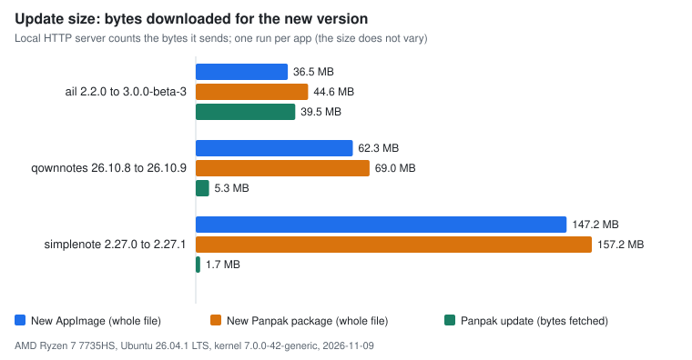
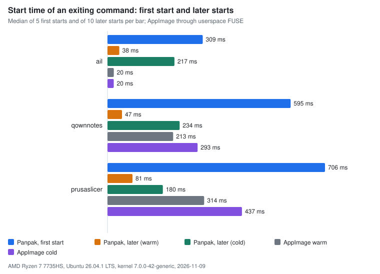
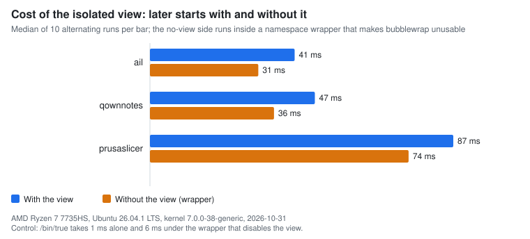
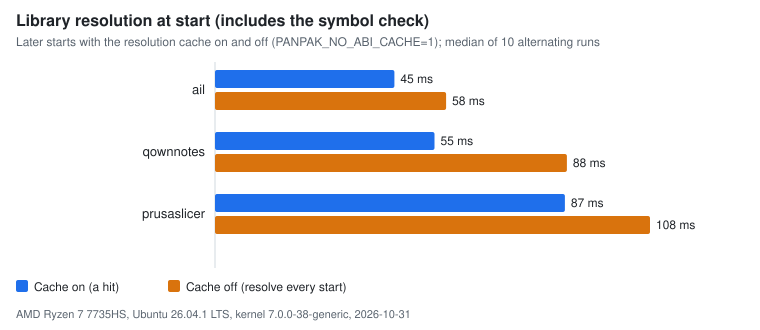

# Benchmarks

Measurements of update size, start time, the cost of the isolated view and library resolution,
made with the scripts in `bench/`. Every number on this page is in a CSV file in
[`bench-data/`](bench-data/), with the machine, the system, the versions and the date at the top of
the file. The charts are drawn from those files. Nothing here is estimated.

Panpak is pre-alpha. These numbers describe one machine and a handful of apps. They are not a
comparison with Flatpak or Snap, which have not been measured.

## Machine and build

| | |
|---|---|
| CPU | AMD Ryzen 7 7735HS, 16 threads |
| Memory | 14 GiB |
| System | Ubuntu 26.04.1 LTS, kernel 7.0.0-38-generic, ext4 |
| Landlock | ABI V8 |
| Bubblewrap | 0.11.1 |
| Build | release, `x86_64-unknown-linux-musl`, rustc 1.99.1 |
| Date of the run | 2026-10-31 |

The CSV files also hold the commit and the first hex digits of the SHA-256 of the two binaries.

## Inputs

All inputs are official AppImages, downloaded by `bench/inputs.py` from the project's release page
and checked against a pinned SHA-256 before use. No input is stored in the repository.

| Name | Version(s) | Use |
|---|---|---|
| AppImageLauncher Lite (Qt 5, small) | 2.2.0 and 3.0.0-beta-3 | update size, starts |
| QOwnNotes (Qt 6) | 26.10.8 and 26.10.9 | update size, starts |
| Simplenote (Electron) | 2.27.0 and 2.27.1 | update size only (no command that exits) |
| PrusaSlicer (GTK 3) | 2.8.1 | starts |

The AppImages are converted with `panpak convert` into signed packages. QOwnNotes needs
`--allow-missing` for Qt libraries that the AppImage does not carry; the commands used here run
without them. The exact options are in `bench/public_bench.py`.

## Update size

Method: two consecutive versions of an app are converted, the older one is installed, and
`panpak update` fetches the newer one from a local HTTP server (`tests/range_server.py`) that logs
the bytes of every response it sends. The count of the server and the count printed by `panpak update`
are the same in every row. The packages are re-signed with a test key so that the update URL points
to the local server; the content is not changed. One run per app: the number of bytes does not vary.

<picture>
  <source media="(prefers-color-scheme: dark)" srcset="bench-data/delta-dark.svg">
  
</picture>

| App | Old to new | New AppImage | New package | Fetched by `update` | Share of the package | Chunks new / total | Requests |
|---|---|---:|---:|---:|---:|---:|---:|
| AppImageLauncher Lite | 2.2.0 to 3.0.0-beta-3 | 36,542,968 | 43,862,052 | 39,504,170 | 90.1% | 1,293 / 1,366 | 40 |
| QOwnNotes | 26.10.8 to 26.10.9 | 62,347,768 | 68,304,440 | 5,280,412 | 7.7% | 151 / 3,200 | 6 |
| Simplenote | 2.27.0 to 2.27.1 | 147,197,267 | 156,373,909 | 1,731,647 | 1.1% | 78 / 5,419 | 12 |

Where Panpak does worse:

- When most of the app changes, an update saves almost nothing: AppImageLauncher between these two
  versions fetches 90.1% of the package.
- The package is larger than the AppImage it comes from: 20% for AppImageLauncher, 9.6% for QOwnNotes,
  6.2% for Simplenote. For AppImageLauncher the update (39.5 MB) is larger than the new AppImage
  (36.5 MB). An AppImage user who updates with a delta tool such as zsync was not measured.

## Start time

Method: the command is one that exits, the same on both sides, and the run must exit with status 0:
`ail-cli --help`, `qownnotes --version` with `QT_QPA_PLATFORM=offscreen`, `prusa-slicer --help`.
Times are measured around `subprocess.run` with a monotonic clock. The commands do not open a window:
the time of the first window is a different measure (see below).

- *First start*: a new isolated HOME, `panpak install`, then the first run, which builds the tree from
  the package, resolves the libraries and fills the cache. Five repetitions, each in a new HOME.
- *Later start, warm*: two runs discarded, then ten.
- *Later start, cold*: the files of the package, the tree and the runtime are dropped from the page cache
  (`POSIX_FADV_DONTNEED`) before each of ten runs. Host libraries stay cached.
- *AppImage*: the original file, run through userspace FUSE (libfuse2), warm (two discarded, ten timed)
  and cold (evicted before each of ten runs).

<picture>
  <source media="(prefers-color-scheme: dark)" srcset="bench-data/start-dark.svg">
  
</picture>

Medians in milliseconds (minimum to maximum in brackets):

| App | `install` | Panpak, first start | Panpak, later, warm | Panpak, later, cold | AppImage, warm | AppImage, cold |
|---|---:|---:|---:|---:|---:|---:|
| AppImageLauncher Lite | 38 | 295 (286-303) | 42 (41-53) | 224 (40-262) | 19 (18-27) | 61 (58-68) |
| QOwnNotes | 49 | 577 (546-600) | 50 (47-62) | 243 (48-254) | 203 (188-227) | 293 (277-306) |
| PrusaSlicer | 63 | 701 (654-709) | 87 (78-94) | 195 (112-210) | 315 (298-326) | 434 (414-457) |

What the numbers show:

- **The first start extracts the app.** It takes 0.3 to 0.7 s here, 7 to 12 times a later warm start.
  An AppImage has no such step. The time depends on the size of the app and on the disk.
- **A later warm start is fast.** For QOwnNotes and PrusaSlicer it is 4 and 3.6 times faster than the
  AppImage, which mounts its image through FUSE at every start.
- **For a very small program Panpak is slower**: `ail-cli --help` takes 42 ms against 19 ms.
- **A cold later start is slow and uneven.** The medians are 195 to 243 ms and the ranges are wide (for
  AppImageLauncher 40 to 262 ms). The spread was not investigated.

The time to the first window of real GUI apps, with a first start and later starts, is in
[COMPATIBILITY.md](COMPATIBILITY.md) (one first start and the median of five later starts, measured by a
different harness).

## Cost of the isolated view

Method: the same installed app, started alternately with the view and without it, ten pairs after two
discarded pairs. Without the view means bubblewrap is made unusable: the run happens inside a user
namespace wrapper in which `/usr/bin/bwrap` is an empty device (the same method as `tests/view.py`), so
the stub starts the app with Landlock alone. That wrapper has a cost of its own, measured with
`/bin/true`: 0.9 ms alone and 5.6 ms under the wrapper, a difference of 4.7 ms that sits on the "without"
side.

<picture>
  <source media="(prefers-color-scheme: dark)" srcset="bench-data/view-dark.svg">
  
</picture>

| App | With the view | Without the view (inside the wrapper) | Difference | Difference plus the 4.7 ms of the wrapper |
|---|---:|---:|---:|---:|
| AppImageLauncher Lite | 41.4 ms | 31.0 ms | 10.4 ms | about 15 ms |
| QOwnNotes | 47.2 ms | 35.5 ms | 11.7 ms | about 16 ms |
| PrusaSlicer | 86.8 ms | 74.0 ms | 12.8 ms | about 17.5 ms |

The view costs about 15 to 18 ms per start on this machine. The last column adds the wrapper's cost on
the assumption that it is the same for these commands as for `/bin/true`, which was not checked. The
"without" side also runs a failed attempt to use bubblewrap at each start (the result of a failure is not
cached), which is small and not separated.

## Fixed cost of a start

Method: `tests/startup_budget.py`. The app is a shell script that exits at once. It is started directly (`/bin/sh script`)
and through the installed launcher, in turn, 40 times each after 3 discarded rounds; the cost is the difference of the
medians. "D-Bus" means the filtered session bus (a systemd scope and `xdg-dbus-proxy`), which the real desktop session
gives and a bare test runner does not. The rows are in [`bench-data/startup-budget.csv`](bench-data/startup-budget.csv).

| Build | D-Bus | Direct | Launcher | Fixed cost |
|---|---|---:|---:|---:|
| main (5c3b3be) | no | 1.1 ms | 41.4 ms | 40.3 ms |
| this branch | no | 1.0 ms | 25.5 ms | 24.5 ms |
| main (5c3b3be) | yes, the stub makes its own scope | 0.8 ms | 57.0 ms | 56.2 ms |
| this branch | yes, the stub makes its own scope (terminal, other launchers) | 1.0 ms | 38.9 ms | 37.9 ms |
| this branch | yes, started in the desktop's scope (`app-gnome-panpak.<id>-<n>.scope`) | 0.9 ms | 26.7 ms | 25.8 ms |

What was done: the two `gsettings` queries start with the process and are read at the end of the preparation; the
D-Bus layer (scope and proxy) is built on another thread from the moment the package is verified, the proxy starts while
systemd makes the scope, and the version of the proxy is remembered between starts instead of asking it at every start.
What is left with D-Bus in the slow case is systemd's `StartTransientUnit` (10 to 20 ms), which must finish before bubblewrap starts so that the app is in the scope; the view itself costs about 15 ms (see above).
`PANPAK_DEBUG=1` prints the time of each stage. The CI runs the script as an advisory step (budget 30 ms, 45 ms with D-Bus);
the step moves into the gate after a week of numbers from the runners.

### The check of the menu entry

At every start of an installed app the runtime reads the first 128 bytes of its menu entry and compares the version
(PANPAK-FORMAT.md §3.1.5). `tests/startup_budget.py --entry-csv` reads the time from two `PANPAK_DEBUG` stages ("package
checked" and "menu entry checked"), 200 starts when the entry is current and 50 when it is older (the entry has no version
line, so the entry and the launcher are both rewritten with a temporary file and `fsync`). The rows are in
[`menu-entry-check.csv`](bench-data/menu-entry-check.csv).

| Case | Median | p90 |
|---|---:|---:|
| Nothing to do | 0.04 ms | 0.05 ms |
| Entry and launcher older, rewritten | 7.78 ms | 8.60 ms |

The script fails when the first case is above 0.3 ms (it does not fail in the advisory CI step).

## System font cache

The view has an empty `/var`; `/var/cache/fontconfig` is mounted into it read-only. Audacity (converted AppImage, Xvfb), the private font cache
folder removed before each start, seconds to a viewable window, 7 starts per variant ([`audacity-font-cache.csv`](bench-data/audacity-font-cache.csv)):
with the system cache the median is 0.70 s, without it 1.24 s (the very first start of each variant, with a cold page cache, was 1.17 s and 2.61 s).
With `fc-match` alone the same effect is 446 ms against 48 ms.

## Library resolution

Method: the same installed app, started alternately with the resolution cache and with it disabled
(`PANPAK_NO_ABI_CACHE=1`, a diagnostic switch), ten pairs after two discarded pairs. With the cache off
the stub resolves the libraries at every start: it reads the ELF files, chooses the libraries and runs the
symbol check (see PANPAK-FORMAT.md section 7). The difference is the cost of that work. The symbol check
is part of it and is not timed on its own.

<picture>
  <source media="(prefers-color-scheme: dark)" srcset="bench-data/resolution-dark.svg">
  
</picture>

| App | Cache on | Cache off | Cost of the resolution |
|---|---:|---:|---:|
| AppImageLauncher Lite | 44.7 ms | 57.6 ms | 12.9 ms |
| QOwnNotes | 54.7 ms | 87.7 ms | 33.0 ms |
| PrusaSlicer | 87.2 ms | 108.4 ms | 21.2 ms |

The cache saves the work, not the checks: the signature, the pin, the index, the stub and Landlock are
checked at every start whether or not the cache is used (see `STARTUP-CACHE.md`).

## Limits of these measurements

- One machine, one system, one kernel. The numbers are not portable to other hardware, disks or
  distributions.
- Three apps for the starts and three for the update size, and only two of them are in both. They were
  chosen because they have a command that exits and two consecutive official releases, not to be
  representative.
- The commands exit before any window: the cost of the toolkit and the window system is not in these
  numbers, and it dominates for large GUI apps.
- Few repetitions (five first starts, ten later starts). The minimum and maximum are in the CSV files.
  There is no confidence interval.
- The AppImage baseline uses userspace FUSE (libfuse2) from a local folder, not a kernel FUSE mount,
  and runs `ail-cli --help` and the others directly.
- Page-cache eviction with `POSIX_FADV_DONTNEED` is a way to get a colder start, not a cold boot.
- The update server is on the loopback interface: the times in `update_seconds` are not network times and
  are not used here.
- Disk use (the package and the tree are both kept) and install time were measured in an earlier cycle,
  see [BENCHMARKS-history.md](BENCHMARKS-history.md); they are not repeated here.
- Flatpak and Snap were not measured.

## Run the benchmarks again

Build the release binaries first, then:

```sh
cargo build --release --target x86_64-unknown-linux-musl   # needs Zig, see README
python3 bench/inputs.py fetch                              # download and verify the inputs
python3 bench/public_bench.py all                          # writes docs/bench-data/*.csv
python3 bench/make_charts.py                               # writes docs/bench-data/*.svg
```

- `PANPAK_BENCH_DIR` (default `~/panpak-bench`) is where the inputs are kept, in its `public` folder.
- `PANPAK_PUBLIC_BENCH_WORK` (default `target/public-bench`) is the work directory. Every run uses an
  isolated HOME inside it; nothing touches your real store.
- `PANPAK_FUSE_LIB` is the folder of `libfuse.so.2` used for the AppImage side (default
  `~/fuse2/lib/x86_64-linux-gnu`).
- `python3 bench/public_bench.py delta|start|view|resolution` runs one measurement; `--out DIR` changes
  the folder of the CSV files.
- The measurements need `bubblewrap`, `python3` with the `cryptography` package (used to re-sign the test
  packages) and about 3 GB of space (inputs, converted packages and one installed app at a time).
- Run on an idle machine. The charts depend only on the CSV files: the same files give the same SVG, in a light and a dark version (`<name>.svg` and `<name>-dark.svg`).
